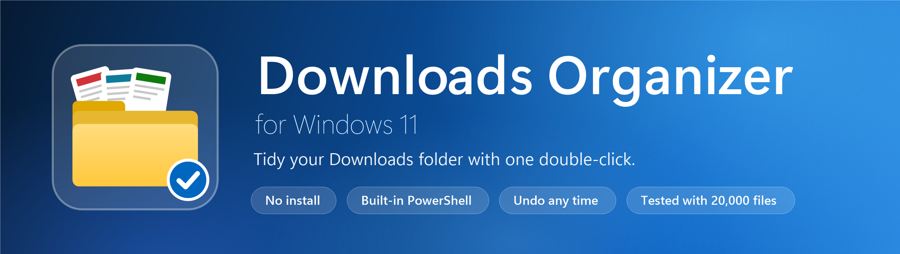
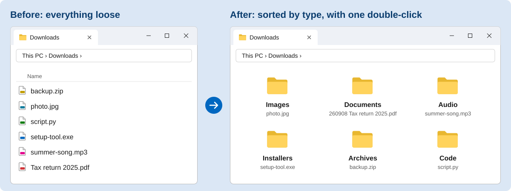

<div align="center">



<br>

<a href="https://github.com/JoshuvaIn/windows-downloads-organizer/releases/latest"></a>


<a href="LICENSE"></a>

### Tidy a messy Downloads folder with one double-click.
See what will happen first, undo it any time, and nothing is ever deleted.

<a href="https://github.com/JoshuvaIn/windows-downloads-organizer/releases/latest"></a>

[How to use it](#how-to-use-it) · [What you get](#what-you-get) · [Quick start](docs/QUICK-START.md) · [How it works](docs/HOW-IT-WORKS.md) · [Compare](docs/COMPARISON.md) · [Testing](docs/TESTING.md)

</div>

<br>



<table>
<tr>
<td width="25%" valign="top"><h3>🖱️ One double-click</h3>No app to install and no rules to write. It uses the PowerShell already in Windows 11.</td>
<td width="25%" valign="top"><h3>👀 Preview first</h3>See every move before it happens. The preview changes nothing at all.</td>
<td width="25%" valign="top"><h3>↩️ Undo any time</h3>Every move is logged as it happens, so even an interrupted sort can be put back.</td>
<td width="25%" valign="top"><h3>🛡️ Never deletes</h3>Nothing is deleted or overwritten. Copies of files you already have go to <code>_copy</code>.</td>
</tr>
</table>

## How to use it

| Step | Do this | What happens |
|:---:|---|---|
| **1** | Copy the **`.sort`** folder into the folder you want to tidy, usually `Downloads`. | Nothing yet. |
| **2** | Double-click **`Sort-Downloads-Preview.bat`**. | A window shows where each file would go. Nothing moves. |
| **3** | Double-click **`Sort-Downloads.bat`**. | Your files move into `Images`, `Documents`, `Videos`, `Code` and so on. |
| **4** | Changed your mind? Double-click **`Undo-Last-Sort.bat`**. | Everything goes back where it was, with its original name. |


> [!TIP]
> Windows may show a blue **Windows protected your PC** box the first time. Choose **More info**, then **Run anyway**. The scripts are plain text, so you can open them in Notepad first if you like.

## What you get

| | File | What it does |
|:---:|---|---|
| ▶️ | `Sort-Downloads-Preview.bat` | Double-click to see exactly what would move. Nothing changes. |
| ▶️ | `Sort-Downloads.bat` | Double-click to sort the folder. |
| ▶️ | `Undo-Last-Sort.bat` | Double-click to put the last sort back. |
| 📄 | `Sort-Downloads.ps1`, `Undo-Last-Sort.ps1` | The plain-text scripts behind the buttons. Open them in Notepad to read them or change which file types go where. |
| 🗂️ | `history\sort-log.csv` | A record of every move, made the first time you sort. Undo uses it. |
| 📘 | `docs\` | A one-page quick start, every rule in plain English, a comparison with other tools and the test notes. |
| ✅ | `tests\Smoke-Test.ps1` | A one-minute check that runs on a throwaway folder. |
| 📦 | Release ZIP | Just the `.sort` folder, for anyone who would rather not use git. |

## How the folders look

```
Downloads\
    .sort\                          <- the tool (copy this folder)
        Sort-Downloads-Preview.bat      look first, changes nothing
        Sort-Downloads.bat              sort the files
        Undo-Last-Sort.bat              put them back
        Sort-Downloads.ps1              the sorting rules and logic
        Undo-Last-Sort.ps1              the undo logic
    holiday.mp4                     <- your loose files, still where they were
    invoice.pdf
    photo.jpg
```

<details>
<summary><b>And after the first sort</b></summary>

```
Downloads\
    .sort\                          <- the tool, stays where it is
        history\                        the log, made on the first sort
    Videos\       holiday.mp4
    Documents\    260908 invoice.pdf    (PDF and Word files get a date at the front)
    Images\       photo.jpg
    _copy\        (only appears if you download the same file twice)
```

</details>

<details>
<summary><b>Where each file type goes</b></summary>

| Folder | What goes in |
|---|---|
| `Images` | jpg, png, gif, svg, webp, heic and other pictures |
| `Videos` | mp4, mkv, mov, avi and other video |
| `Audio` | mp3, wav, flac, m4a and other sound |
| `Documents` | pdf, Word, PowerPoint, Excel, csv, txt, epub and similar |
| `MarkItdown` | Markdown (`.md`) files |
| `Code` | Python, JavaScript, Java, C, C++, C#, HTML, CSS, JSON, SQL and about 75 other code formats |
| `Archives` | zip, rar, 7z, tar, iso and similar |
| `Installers` | exe, msi, msix |
| `Other` | everything else |

</details>

## Good to know

- **Windows 11 only.** Built and tested on Windows 11 with the PowerShell that comes with it. Other versions of Windows are not tested or supported, and it does not run on Mac or Linux.
- It sorts by file type, using the extension. It does not read inside files.
- It leaves alone anything hidden, any unfinished download, and anything changed in the last two minutes.
- It runs when you start it. It does not watch the folder or run on a schedule.

## Stress test, in short

> **20,000 files in one folder: sorted, sorted again and fully undone, with no file lost or overwritten.**
>
> It was also tried with files locked by other programs, two copies started at once, the log open in Excel, and sorts killed half-way. Details are in [the test notes](docs/TESTING.md).

## Licence

GNU General Public Licence, version 3. You may use, change and share it, and if you share a changed version it must stay open source under the same licence. See [LICENSE](LICENSE).

<div align="center">
<br>
<sub>Made for Windows 11. If it saved you a tidy-up, a ⭐ helps other people find it.</sub>
</div>
