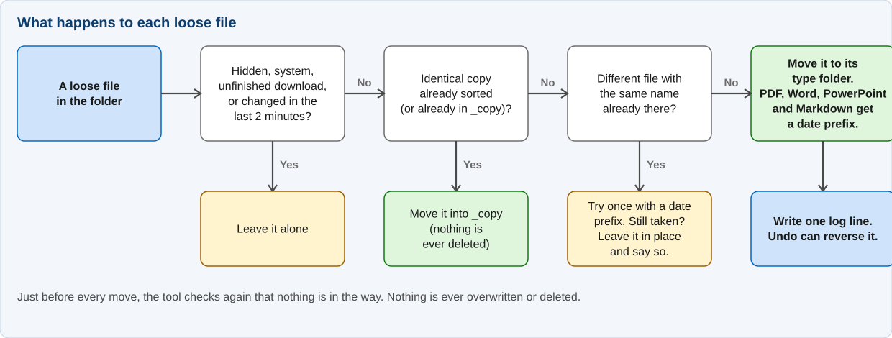

# How it works

Plain English, in the order things happen. If you only want to use the tool, the [quick start](QUICK-START.md) is enough.

## Which files it touches

Only files sitting **directly** in the folder. It leaves alone subfolders, hidden and system files, unfinished downloads (`.crdownload`, `.part`, `.tmp` and similar), and anything changed in the last 120 seconds, in case it is still downloading.

## Where files go

| Folder | What goes in |
|---|---|
| `Images` | jpg, png, gif, svg, webp, heic and other pictures |
| `Videos` | mp4, mkv, mov, avi and other video |
| `Audio` | mp3, wav, flac, m4a and other sound |
| `Documents` | pdf, Word, PowerPoint, Excel, csv, txt, epub and similar |
| `MarkItdown` | Markdown (`.md`) files |
| `Code` | Python, JavaScript, Java, C, C++, C#, HTML, CSS, JSON, SQL, scripts and about 75 other code formats |
| `Archives` | zip, rar, 7z, tar, iso and similar |
| `Installers` | exe, msi, msix |
| `Other` | everything else |
| `_copy` | copies of files that are already sorted |

Folders are only created when a file needs one. Upper and lower case do not matter (`PHOTO.JPG` is a picture). The full lists are at the top of `Sort-Downloads.ps1`.

## The date at the front of some names

PDF, Word, PowerPoint and Markdown files get `YYMMDD` in front: `Tax return.pdf` becomes `260908 Tax return.pdf`.

- The date is the **earlier** of the created and modified dates. Copying a file resets its created date to "now", so using the earlier one keeps old files looking old.
- Names that already start with a date are left as they are.

## Duplicates and clashes

- **A copy of a file you already sorted** goes to `_copy` under its own name. "Copy" means the same size, the same name (or the same name with a date) and the same modified time.
- **A different file with a name already in use** gets one more try with a date at the front. If that is taken too, it stays where it is and the screen says so.
- Nothing is ever overwritten or deleted.

## Undo

Each move is logged as it happens, in `.sort\history\sort-log.csv`. Undo works through the latest sort and puts each file back, but only if the file is still where it was put and has not changed since. If a different file now sits at the old name, that file is skipped and tried again next time. `Undo-Last-Sort.ps1 -GiveUp` stops retrying and moves on to older sorts.

## Safety checks

- It refuses to run on a drive root such as `C:\` or on Windows' own folders.
- Only one sort or undo can run on a folder at a time.
- If the log is open in another program, the tool waits and retries rather than stopping.
- A file that cannot be moved is reported and the rest carry on.

## Settings you might change

All at the top of `Sort-Downloads.ps1`:

| Setting | Default | What it does |
|---|---|---|
| `$Categories` | the table above | Which file types go where. |
| `$DuplicatesFolder` | `_copy` | Where copies go. `''` leaves them in place instead. |
| `$StampFormat` | `yyMMdd` | `yyMM` gives year and month only. |
| `$MinAgeSeconds` | `120` | Skip files changed more recently than this. |
| `$IncludeSubfolders` | none | Subfolders whose files should also be sorted. |
| `$HashCheck` | off | Also spot copies by content, even with a different name. Slower. |
