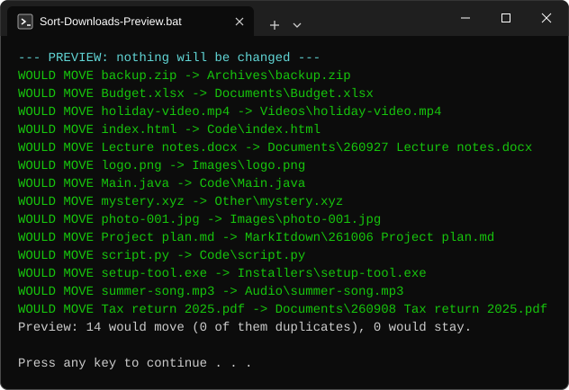
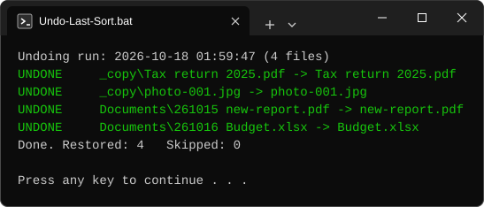

[← Back to README](../README.md)

# Quick start (Windows 11)

Five minutes. No installing, no settings. Built and tested for Windows 11.

## 1. Put the tool in the folder you want to tidy

Copy the whole **`.sort`** folder into it. For most people that is `Downloads`.

```
Downloads\
    .sort\                          <- the tool (copy this folder)
        Sort-Downloads-Preview.bat      look first, changes nothing
        Sort-Downloads.bat              sort the files
        Undo-Last-Sort.bat              put them back
    holiday.mp4                     <- your loose files, still where they were
    invoice.pdf
```

The tool always tidies **the folder that contains `.sort`**, and nothing outside it.

> Making the folder by hand? File Explorer will not accept a name that starts with a dot. Type `.sort.` (a dot at each end) and Windows will tidy it to `.sort`. Copying the folder avoids the problem.

## 2. Look first

Open `.sort` and double-click **`Sort-Downloads-Preview.bat`**. A window lists every file and where it would go. Nothing is moved or created.



## 3. Sort

Double-click **`Sort-Downloads.bat`**. You get the same list with `MOVED` instead of `WOULD MOVE`.

If the folder is not called `Downloads`, you will be asked to type `YES` first. That stops you tidying the wrong folder by accident.

## 4. Undo, if you want

Double-click **`Undo-Last-Sort.bat`**. Your files go back under their original names. Run it again to go back one more sort.



## If something looks different

| You see | What it means |
|---|---|
| **Windows protected your PC** | Windows is careful with files from the internet. Choose **More info**, then **Run anyway**. Or, before unzipping, right-click the ZIP, choose **Properties**, tick **Unblock** and press OK. |
| `LEFT` | A file was left where it is. The line says why (for example, a different file with that name is already there). |
| `FAILED` | A file could not be moved, usually because another program has it open. Close that program and sort again. |
| `Skipped 3 file(s) changed in the last 120 seconds` | They look like downloads in progress. Sort again in a couple of minutes. |
| `Another sort or undo is already running` | A second copy was started on the same folder. Wait for the first. |
| Files in `_copy` | Copies of files you already had. Have a look and delete what you do not need. The tool never deletes them. |

## Good to know

- No administrator rights are needed, and nothing is sent anywhere.
- Keep the `history` folder inside `.sort` if you want undo to reach back over older sorts.
- To change where file types go, open `Sort-Downloads.ps1` in Notepad. The settings are at the top, with plain-English notes.

---

[← Back to README](../README.md)
